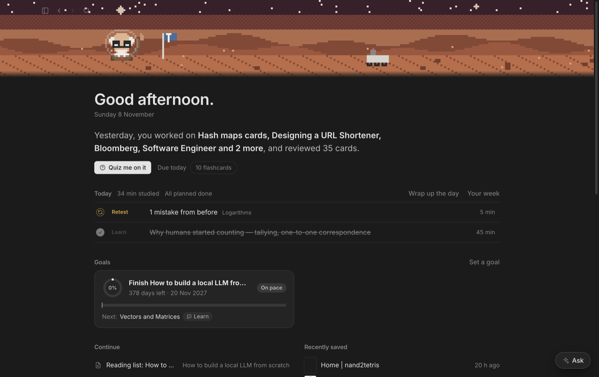
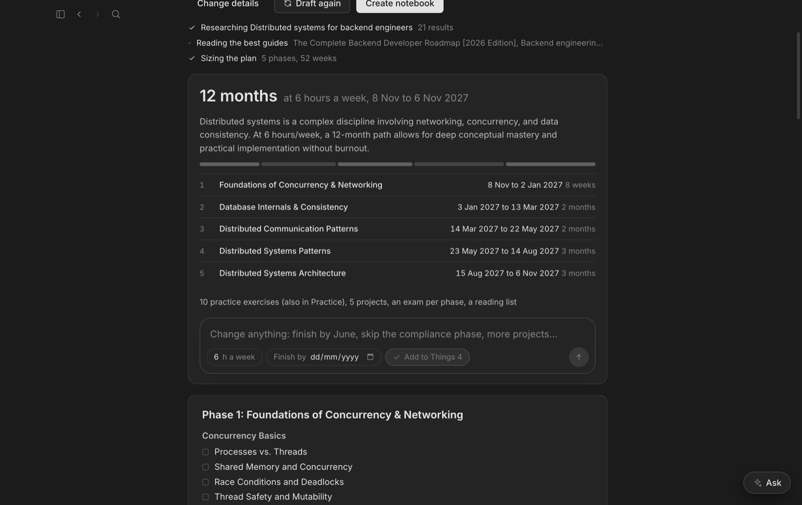
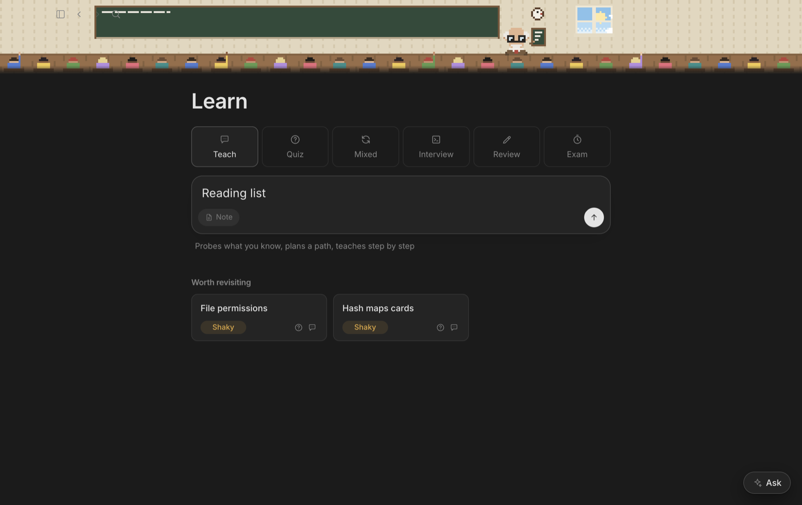
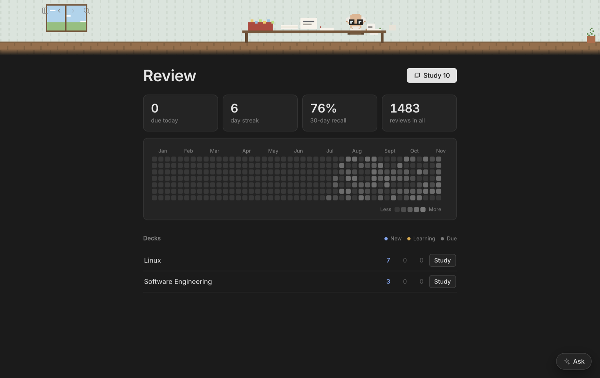

<h1 align="center">Tide</h1>

<p align="center">A local-first study app for macOS: your notes, a tutor that teaches, quizzes and talks, all on your Mac.</p>

<p align="center">
  
  
  
  
</p>

<p align="center">
  
</p>

## Features

- **Your notes, your files.** Works on a folder of Markdown notes (an Obsidian vault). Everything stays plain text you own.
- **A tutor that teaches.** Teach, quiz, mixed practice, exams and mock interviews (coding, system design, quant, behavioural) with grading, hints and flashcards from your mistakes.
- **Plans you can talk to.** Name something to learn and Tide researches it, sizes a phased plan with dates, and writes the outline. Change it in plain words: "finish by June", "10 hours a week".
- **Learn visually.** The tutor draws diagrams and pulls real figures as it explains. Click any picture to see it large.
- **Talk to it.** A natural on-device voice and dictation, with hands-free conversation and four tutor characters.
- **Spaced review.** Flashcards scheduled with FSRS, a mistake journal with retests, and study time tracked for you.
- **Your day and week.** Today's agenda, goals, a wrap-up and a weekly review, kept in step with Things 4.
- **Private by default.** Runs on a local model (Gemma 4 through MLX) or any OpenAI-compatible server you choose.
- **A stronger model when it counts.** Optionally send the hardest jobs (checking maths, finding your mistakes, marking, planning) to Groq, Qwen, Gemini or any OpenAI-compatible API, with a usage page that shows exactly what the cloud cost.

<p align="center">
  
  
</p>
<p align="center">
  
</p>

## Install

Requirements: macOS on Apple silicon, Node 22.

```sh
git clone https://github.com/mazidhee/tide.git
cd tide
npm install
npm run dist:mac   # builds dist/Tide-<version>-arm64.dmg
```

Open the DMG and drag Tide to Applications.

For the AI, run any OpenAI-compatible server. To run it locally with MLX:

```sh
pip install mlx-vlm
mlx_vlm.server --model mlx-community/gemma-4-12B-it-4bit --port 8080
```

## Usage

1. Open Tide and choose your notes folder.
2. In **Settings → AI**, set the server address (`http://127.0.0.1:8080/v1` for the command above).
3. Start from **Learn** (pick a mode and a topic), **New topic** (get a plan), or **Chat**.
4. Optional: in **Settings → Voice**, set up the natural voice for Talk.

The full guide is in [`docs/user-guide.md`](docs/user-guide.md) and inside the app under **Help** (⌘?). Building and architecture notes are in [`docs/development.md`](docs/development.md).

## Development

```sh
npm run dev        # run with hot reload
npm test           # tests
npm run typecheck
```
