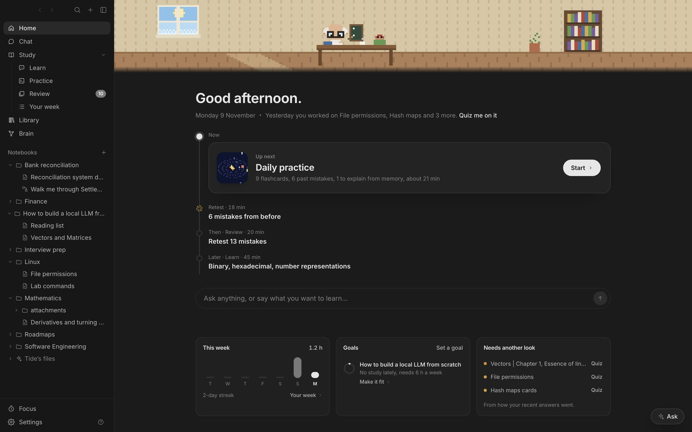

Tide opens your Obsidian vault and treats it as the place you learn. You read and write your notes in it, save books, articles and YouTube videos to its Library, and a tutor teaches you from all of it. The tutor is Gemma 4 running on your Mac, so your notes stay on your Mac unless you choose otherwise.

## Three ideas behind it

- **Your notes stay yours.** Tide reads and edits the Markdown files in your vault. Every note still opens in Obsidian. Tide's own data (review history, quiz results, highlights) lives in a hidden `.tide` folder next to your notes.
- **You do most of the work.** The tutor asks you to predict before it explains, gives problems that get harder when you're right and easier when you're not, and points at the exact step where an answer goes wrong.
- **It plans for you.** Tide works out where you're heading from your notebooks and progress, plans each week to get you there, and puts today's work on Home.

## The window

| Part | What's there |
| --- | --- |
| Sidebar | Home, Chat, Study (Learn, Practice, Review, Your week), Library and Brain, then your notebooks. Hide it with <kbd>⌘\</kbd>. |
| Main area | Whatever you're working on: Home, a note, a PDF, a notebook, a lesson. |
| Ask | The button at the bottom right opens the tutor beside anything you're reading. <kbd>⌘J</kbd> toggles it. |
| Menu bar | Your tutor, acting out what you're doing, with today's plan and a focus timer. |

## Getting around

- **Back and forward** sit at the top of the sidebar (<kbd>⌘[</kbd> and <kbd>⌘]</kbd>).
- Lessons, quizzes, interviews and exams keep their place when you leave them. Come back with Back, or from **In progress** in the sidebar.
- **Study** folds Learn, Practice, Review and Your week together. **+** at the top makes a note, a new topic, saves a link or adds files. Tide's own folders (your week, journal, mistakes, exams, designs) fold away under **Tide's files**.
- **Own window** (the ↔ button) moves a lesson, an exam or a drill into a window of its own. The window closes when you finish.
- <kbd>⌘K</kbd> searches note titles, the full text of notes, PDFs and saved pages, and quick actions. The last row asks the tutor your search as a question.

## Appearance

**Settings → Appearance** has seven themes: Match system, Light, Sepia, Graphite (a neutral, editor-style dark), Slate, Midnight (true black) and Ember (warm dark). It also sets the line width, text size and reading font (Sans or Serif) for all notes. **Sidebar** lets you untick anything you don't use; hidden items stay in the menu bar and shortcuts.

## Where to go next

If Tide isn't running yet, start with [Set up Tide](02-setup.md). If it is, [A study day, start to finish](10-flow-day.md) shows how the parts fit together.
