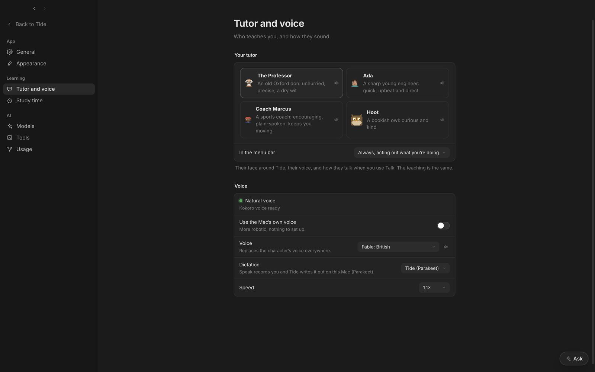

```animation
wave
```

1. **Set up the natural voice.** **Settings → Tutor and voice**, then set it up. It installs Kokoro (speech) and Parakeet (dictation) in Tide's own folder, about 1 GB, once.
2. **Pick a voice.** Under **Voice**, choose **The tutor's own**, **Lewis** (deeper, British), **Fable**, **Daniel** or **George**. The speaker button plays a sample.
3. **Choose how you dictate.** **Dictation** is **Tide (Parakeet)** or **Handy**.
4. **Turn on Talk.** In a lesson or Chat, turn on **Talk**. The tutor opens each reply with a short spoken part and reads the question out; the full answer stays on screen, so long answers aren't read word for word.
5. **Answer out loud.** Click **Speak**, talk, click again. Or turn on **Hands-free** and just talk: Tide hears when you stop. <kbd>Space</kbd> or <kbd>Esc</kbd> interrupts the tutor.



## Dictating with Handy

With **Dictation** set to **Handy**, pressing **Speak** puts the cursor in the answer box; then press your Handy shortcut and Handy types what you say. Hands-free talk still uses Tide's own model, because it needs to hear when you stop.

Both are good: on your own recordings, Tide's model wrote out almost exactly what Handy did.

## Speed

Kokoro writes speech about 26 times faster than real time, so a reply starts within about a second. Dictation writes down what you said in a fraction of a second. Both run on your Mac.
