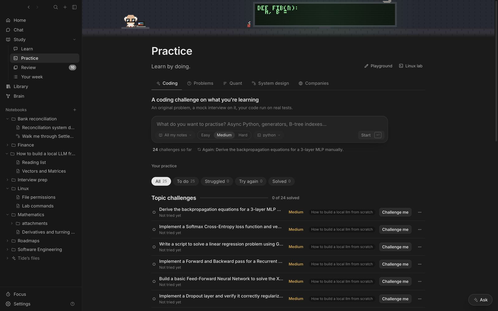

1. **File what you have.** Put anything about the company in the Library under its name: the job description, articles, notes from a call. The plan is drafted from them first.
2. **Research.** **Practice → Companies**, type the company, the role and an interview date, and press **Research**. Tide reads recent interview reports and drafts the loop round by round, checklists for coding, system design, behavioural themes and domain knowledge, practice problems, questions to ask them, and the sources it used.
3. **Save the plan.** **Save plan** keeps it in **Interview prep**.
4. **Run the rounds.** Each plan has a **Coding round**, **System design** on a canvas and **Behavioural** (STAR stories, probed like a hiring manager would).
5. **Make it real.** With **Timed, 45 min, no hints** ticked, a clock counts down (amber for the last five minutes), there's no hint button, and the interviewer stops at zero and scores you.
6. **Watch the score move.** Each plan shows your latest score per round, how it changed since the last try, and the last verdict.

## Quant and trading interviews

**Speed drills** are mental maths against the clock: the **Arithmetic sprint** (two minutes, as many as you can) and **80 in 8** (eighty questions with decimals, fractions and percentages in eight minutes). A right answer moves on by itself.

A **Quant interview drill** asks one question at a time in probability, expected value, statistics, brainteasers, market making or options, in a firm's style if you choose one (Jane Street, Optiver, SIG…). The interviewer checks every answer with real maths or a simulation before grading it, asks how you got it, and ends with a scorecard on accuracy, speed, reasoning and composure.

## System design rounds

The canvas has components on the left (client, load balancer, service, database, cache, queue). Drag from a component's dot to connect, double-click to rename, <kbd>⌘Z</kbd> to undo.

- **Interview me** runs a design interview: requirements first, you draw, it probes the hard parts.
- **Review my design** and **What breaks at 10x the load?** critique what you drew.
- **Redraw from memory** opens a blank canvas and scores what you redraw against what you learned.

Designs are saved as `.canvas` files in **Designs**, the format Obsidian uses.
