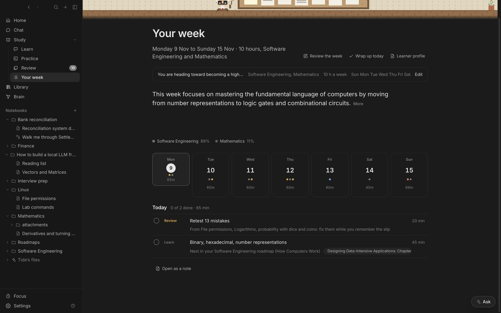

## What you're working towards

List your **aims** in **Edit**: as many as you have, in your own words, each **Main**, **Side** or **Curious**. Reword, reweigh or remove them whenever your interests change. With no aims yet, Tide offers its own guess from your notebooks; **Use it** or write your own.

- **Main:** most of your weekday time. Each main aim's roadmap gets weekday time every week.
- **Side:** a steady, smaller share.
- **Curious:** weekend reading and primers, never weekday study.

## How Tide sorts your roadmaps

In the background, Tide sorts every roadmap against your aims: what each section is for, how much each aim needs it, and which topics are history or background rather than skills. Your own heading tags (CORE, LATER, OPTIONAL…) are kept, except that a main aim can bring a LATER section forward. Sorting is redone only for what changes: new topics, or new aims. Private projects are sorted on your Mac.

On a roadmap page, each topic shows where it sits: **Weekdays**, **When needed**, **Weekend**, **Later** or **Skip**. Click it to move that topic, or its whole section; your choice always wins. The roadmap's **Next** follows the plan, not just the order of the file.

## How the week is planned

By default **Tide picks** the week's roadmaps; switch to **I do** to pick them yourself (Tide still says what it would have picked). The scheduling is done in code, not guessed by the model:

- **Which roadmaps:** at most two on weekdays, by how much your aims need what comes next in each (a foundation counts for what it leads to), plus any deadline that's behind.
- **What from each:** your roadmap's order, skipping what isn't needed now. History like *the invention of zero* becomes a short weekend primer, never a weekday lesson.
- **When:** set **Weekdays** and **Weekends** in minutes. Weekends get one subject, the take-home and at most one primer.

Each study day gets a few items, sized to your time:

- topics to **learn**, straight from your roadmaps, never invented,
- **practice**, a short **quiz** on earlier topics and **review** of weak spots,
- a **take-home** and a **test** at the end.

Each item says why it's there ("Consensus, for distributed systems and blockchain infrastructure"). Finishing a lesson ticks it off here and in the roadmap.

## Checking what you know

The first time a section comes up, a **Check** goes just before its first lesson: up to six quick questions, hardest first. Topics you know are ticked off and their lessons this week marked done; rusty ones become short **refreshers** (problems first, explanation only where you miss); the rest are taught as usual. Each section is checked once, so early material you learned at school costs a quiz, not weeks.

## Auditing a roadmap

**Audit** on a roadmap page gives a frank review and, under it, **suggested changes** from your aims: move topics or sections (weekdays, weekend, later, skip), or add a missing prerequisite after a topic. Nothing changes until you **Apply** one; moves are recorded as your choices, and an added topic is one new line in the roadmap.

## Free readings

For the week's lessons, Tide finds a few free, legal readings: a landmark paper, an RFC or spec, official docs, an open textbook chapter, and Wikipedia. Each is checked to exist before it's kept. Small PDFs from open archives (arXiv, RFCs, project and course sites) are saved into the Library under the notebook, so lessons use them too. Piracy sites are never used, and nothing is looked up for private projects. Turn web search off in Settings to stop it.

## Reading the page

- Why the week is shaped the way it is, in a sentence (**More** for the rest).
- How the time splits between subjects.
- A strip of seven days with dots for each item, today circled.
- The chosen day's items as a checklist, with what to read as small links.

**Send to Things** puts the week in Things 4, a heading per day. The week is also a note, `Coach/This week`, you can edit. Ask “am I on track?” in any chat and the tutor checks your plan.

## Your learner profile

`Coach/Learner profile` is a short note of your goal, focus, strengths, weak spots and how you learn best. It's what the tutor carries into every conversation instead of your whole history, which keeps answers fast on a local model. Edit anything that's wrong; your edits to “How they learn best” are kept.

## Looking back

The weekly review shows each day's activity notebook by notebook and your journal lines, then asks what went well, what got in the way and what to change. **Save and plan next week** plans with that in mind: a week you didn't finish makes the next one lighter.
