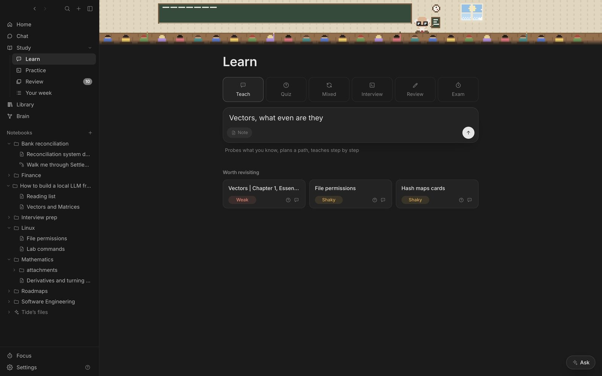

| Mode | How it runs |
| --- | --- |
| Teach | Finds your level with 2–3 questions, plans the steps, then teaches with problem sets that get harder or easier. Ends with mixed problems. |
| Quiz | 5–20 adaptive questions of mixed types. Ends with strengths and misconceptions. |
| Mixed | A quiz that interleaves several notes or notebooks. |
| Interview | A coding interview in your language: approach, code, review, follow-ups and a verdict. |
| Review | Grades a note you wrote, then challenges specific sentences. |
| Exam | A timed paper with a mark scheme, marked when you finish. |

## How a lesson runs

**Teach** works the way the best tutors teach: you do most of the work. It starts with two or three questions, easy to hard, to find your level, then writes a short plan that skips what you already know. Each step is a short explanation with one worked example, then problems one at a time, labelled like **Problem 2 · harder**.

```animation
ladder: Right first time, Harder, Right with hints, Same level
```

- Right first time: the next one is harder.
- Right with hints: a fresh one at the same level.
- Wrong: an easier one, or just the missing piece re-taught.

A step is done after two right in a row without hints. It ends with a few mixed problems across the whole lesson.

## Answering

- **Question types:** predict, short answer, multiple choice, explain it back, spot the error, worked problem, code.
- **Confidence:** Guessing, Unsure or Sure. Confidently wrong counts as a misconception.
- **Hints:** Nudge, Hint, Show a step, Show the answer.
- **I don't know:** the tutor teaches the idea briefly and asks an easier question.
- **Submit** with <kbd>⌘↵</kbd>.

## Notes as you learn

In **Teach**, a notes pane sits beside the lesson: the tutor's key ideas go into the topic's note under **From the lesson**, and you write your own anywhere in it. **Review my notes**, or typing “review my notes” as your answer, sends what you wrote to the tutor: what's right and why, up to three things to fix, then a problem on the weakest point.

## Pictures

Paste a screenshot of a textbook page or diagram into a note and the tutor teaches from it, showing the picture it's talking about. Pictures are only sent when they matter (the start of a lesson on that note, or when you ask about a figure), each adding about a quarter of a second.

## Web search in lessons

With **Web** on, the tutor looks things up when a topic may be newer than its training or it's unsure of a fact, and cites what it read. It knows today's date, so for anything that changes it searches recent results. It can also search arXiv and read online PDFs.

## If Tide closes mid-lesson

Lessons and exams are saved as you go, to `.tide/ongoing.json` in your notes folder. If Tide quits, the Mac restarts or the power goes, the lesson is back under **In progress** in the sidebar when Tide opens, exactly where you were. If the tutor was in the middle of a reply, it's asked for again.

## How Tide checks the tutor

Gemma is a small model, and on hard material it can set a broken problem or mark a half-right answer as right. So every lesson reply is checked before you work on it:

- **The tutor solves its own problem first.** With each problem it writes its answer and key steps, hidden from you, and marks your answer against them.
- **What can be computed is computed.** For a problem with a numeric or algebraic answer, the tutor also writes a short SymPy check (for code, test cases), and Tide runs it. If it fails, the problem or the answer is wrong.
- **If it didn't solve it, Tide does.** When the tutor sets a problem without its answer, a short separate call works it out (the cloud model on hard topics, when it may), runs the check, and keeps the answer with the problem for marking. Measured on 40 hard questions, marking against a solution took Gemma from 80% to 90% right, with no wrong answer marked correct.
- **A second look by a stronger model.** With the cloud helper set to mark answers, the cloud model reviews each new problem (is it well posed, is the answer right?) and any **Correct** or **Partly right** just given (was it earned?). Gemma doesn't review itself: measured, that made marking worse. Private projects and your Metabase never go to the cloud.
- **No repeats, no missing questions.** A problem it already asked, or one that never actually asks anything, is caught too.

If anything fails, the reply is taken back and written again, once, with what to fix; you'll see a moment of "Checking the problem and the mark" above it. Each verdict quotes the part of your answer that earned it.

## Problems ready before you need them

Tide keeps a **problem bank** for the topics coming up: problems written ahead of time by the cloud model, each with its solution, a SymPy check where the answer can be computed, and a review by a second model. Only problems that passed go in front of you.

- In a problem set, when the tutor gives its feedback and starts the next problem, Tide stops it there and puts in a checked problem from the bank instead: harder after a right answer, the same level after a partly right one, easier after a wrong one. Replies come about three times faster, because the tutor writes less.
- While you work on a problem, the next ones are prepared in the background (by the cloud model, or by Gemma while it's idle).
- You can start answering as soon as a reply is written; its checks finish behind it. If you answer before they're done, they stop, so your answer goes first.

## Instant answer checks

When a problem's answer is a number or an expression, SymPy compares yours with the solution before the tutor marks it, so 1/2, 0.5 and 2/4 agree and a wrong result can never be marked correct. You'll see **Checked your final answer** above the reply. The tutor still marks your reasoning.

## Built around your mistakes

- **Worked examples first.** The first problem of a lesson, and the one after a miss, comes worked out up to the last step: you finish it. After that, problems come in full. Learning a new idea goes best this way.
- **Aimed at what you missed.** After a wrong or partly right answer, a problem on exactly that idea is written for you (from the tutor's own feedback) and comes next.
- **Ready when you start.** Lessons in your plan have their opening written ahead (taught from your book where you own one), so they start at once.

## Taught from your books

When a book you own covers the lesson's topic, the lesson is taught from that section: its definitions, notation and examples, with problems that follow from it. Where the model's memory and the book disagree, the book wins.

## No repeated problems

The tutor writes a new problem each time. If a reply asks a problem it already asked in that lesson, Tide takes the reply back and has the tutor write a new one, before you answer it.

## Grading and flashcards

Each answer is **Correct**, **Partly right** or **Not quite**, with feedback. When you miss something, the tutor writes a flashcard for it. **Add to flashcards** saves it next to the note.
