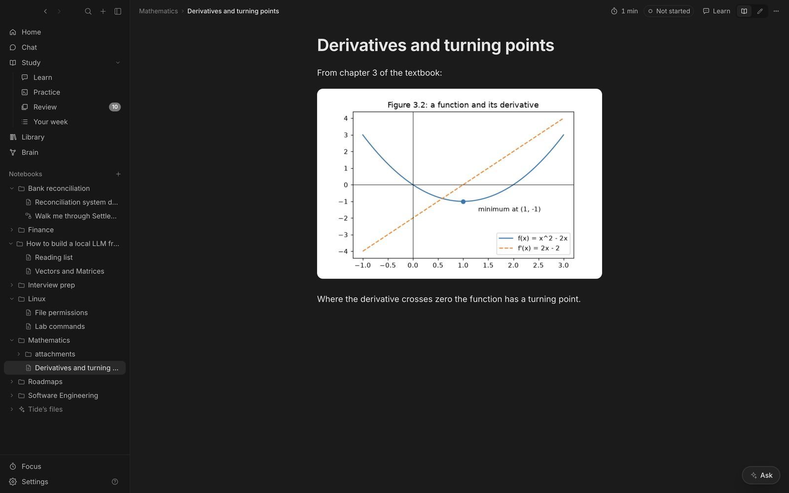

## What renders

Headings, LaTeX (`$…$`, `$$…$$`), `[[wikilinks]]` and `![[embeds]]`, callouts, `==highlights==`, tags, task lists, code with a Copy button, YouTube players and Mermaid diagrams. Click a link to a note that doesn't exist and Tide offers to create it. Long notes show short dashes on the right edge, one per heading; hover to see them. If you change a note in Obsidian, Tide picks it up.

## Test me

**Test me** takes the paragraph you're on and asks one pointed question beside it: why it works, what happens at an edge case, how it connects to something else. It never explains first. Answer in the margin and it pushes back or goes deeper.

## The writing coach

Turn on **Coach** and write in your own words. Each time you pause, it reads the paragraph and leaves one note:

| Note | Means |
| --- | --- |
| Question | Probes your reasoning: why, what if, how it connects |
| Check this | Something looks wrong, with what to check |
| Missing piece | A step your explanation skips |
| Clearer | A tighter way to say it |

**Apply** uses a rewrite; **Keep mine** dismisses it.

## Threads

Hover any paragraph, equation or code block and click ✦. A thread opens under it with **Question me**, **Explain**, **Example**, **Quiz me**, **Draw it** and **Ask the panel**. **Add to note** writes an answer into the note as a callout. Selecting text gives you the same actions.

## Page settings

The ⋯ button on a note sets things for that note only: font, text size, full width, how much the tutor joins in (**Off**, **When I ask**, **Questions me when I pause**, **Challenges every claim**), who reads it, and how the tutor should help (“Quiz me before Friday”).

| Reads as | Looks for |
| --- | --- |
| Tutor | Gaps in understanding, missing intuition |
| Interviewer | Complexity, edge cases, off-by-one errors |
| Professor | Unjustified steps, loose definitions, missing cases |
| Staff engineer | Behaviour at scale and under failure, trade-offs |
| Editor | Vague wording, unsupported claims |
| Skeptic | Overconfident claims and counterexamples |
