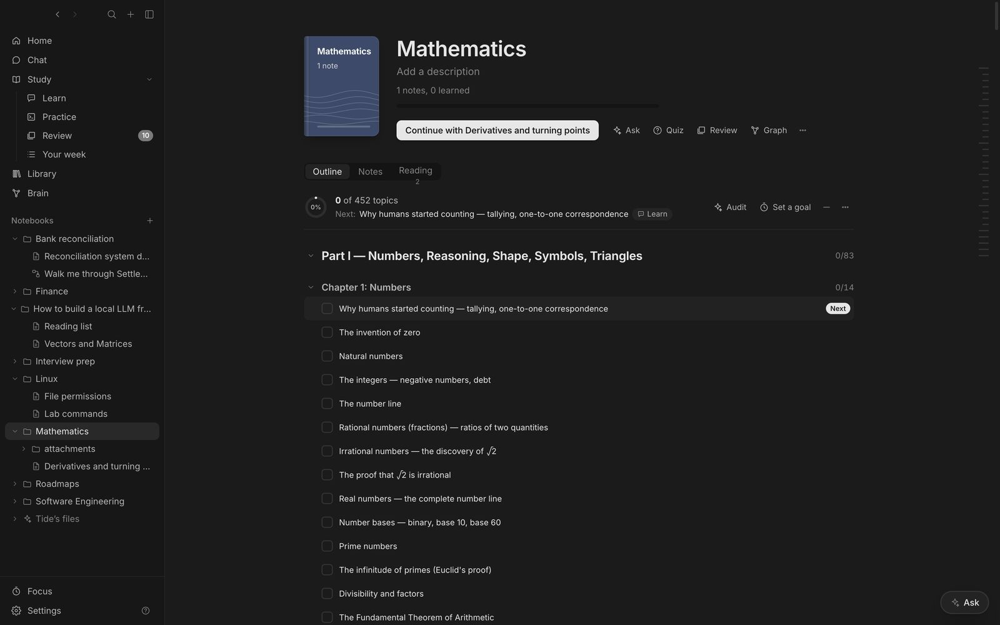

## The notebook page

It shows how many notes you've learned, a progress bar and **Continue with…** the last note you opened there. Ask, Quiz, Review and Graph all work on just that notebook. The **Reading** tab lists everything in the Library filed under the notebook's name.

**Covers:** hover a cover and click the picture button, or drag an image onto it. Images are copied into `.tide/covers`.

## Editing the outline

| Key | Does |
| --- | --- |
| <kbd>Enter</kbd> | Add a topic |
| <kbd>Tab</kbd> / <kbd>⇧Tab</kbd> | Indent or outdent |
| <kbd>⌥↑</kbd> <kbd>⌥↓</kbd> | Move a topic |
| <kbd>⌘Enter</kbd> | Tick it |
| <kbd>Backspace</kbd> | Delete an empty topic |

- **Link topics to notes.** A topic whose title matches a note shows a dashed suggestion; **Link N matching notes** applies them all.
- **Sources.** A topic written as `Topic — _Book, Author_` shows the book quietly after it.
- **Contents.** Long outlines have marks on the right edge, one per part and chapter. Hover for the full contents with progress; type to find any topic.
- **Collapse all** folds the roadmap to its section titles with their progress.

## Learning status

Each note has a status (**Not started**, **Learning**, **Reviewing**, **Learned**), stored in its frontmatter as `learning_status`. Renaming or moving a notebook folder keeps its outline, description, goals and cover.
