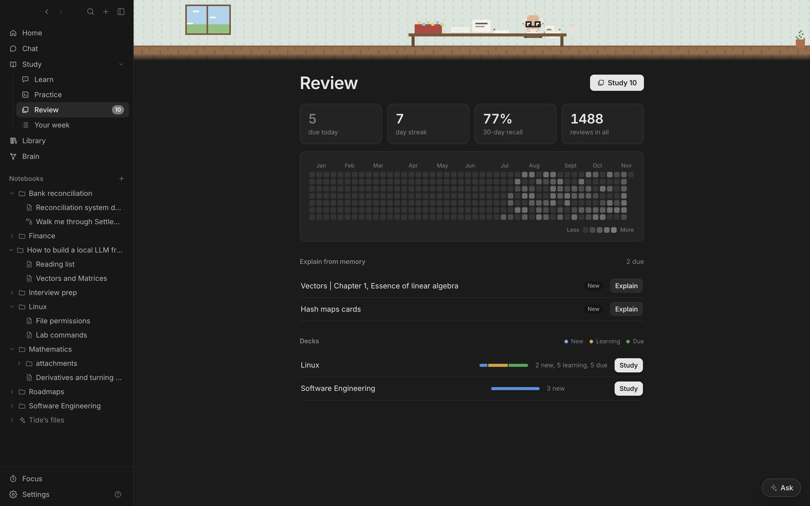

## Writing cards

| Format | Example |
| --- | --- |
| One line | `What is a log?::The inverse of an exponent` |
| Both ways | `Big O of binary search:::O(log n)` |
| Multi-line | Question lines, a line with just `?`, then answer lines |
| Cloze | `The {{c1::Pythagoreans}} proved √2 is irrational` |
| Highlight cloze | `A ==hash map== maps keys to values` in notes tagged #flashcards |

The tutor can write cards too: **Flashcards** in a note's toolbar, **Flashcard** on a selection, or misses in a quiz.

## Studying

**Study** starts every card due. <kbd>Space</kbd> flips, <kbd>1</kbd> (Again) to <kbd>4</kbd> (Easy) grades; each button shows when you'll see the card next. **Type my answer first** makes you commit before you flip. **Explain** asks the tutor about a card. Cards you keep forgetting are flagged as leeches with **Re-learn this**, which starts a lesson on the idea.

## Explain from memory

Notes come back to be explained from memory on their own schedule. Write what you remember and the tutor marks it against the note.

## Mastery

Every answer and review is recorded. Each note gets a level, **Weak**, **Shaky**, **Solid** or **Mastered**, from recent answers (newer count more), its flashcards and the status you set. Levels show on outlines, notebooks and the Brain; **Learn → Worth revisiting** lists the weakest.
