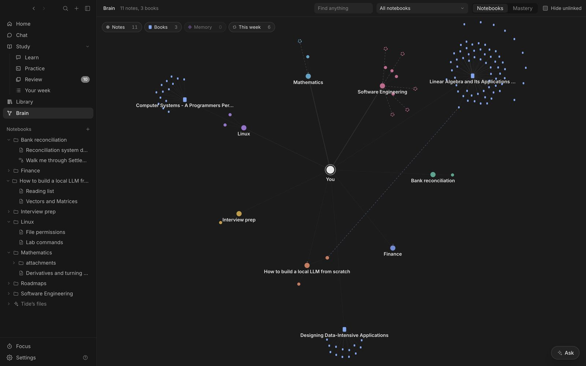

- **You** in the middle; click it for where you're heading.
- **Notebooks** with a ring showing how far through the roadmap you are, and their notes linked as you link them.
- **Books** and their chapters, each tied to the notes it covers.
- **What the tutor remembers** about you, as diamonds near you.
- **This week's topics** as dashed rings.

## Live

When the tutor remembers something, grades an answer, maps a book or plans your week, the node it touched glows and **Live**, bottom left, says what happened. Click a line to select its node.

```animation
brain
```

Turn layers on and off along the top (Notes, Books, Memory, This week). **Notebooks / Mastery** switches the colours; in Mastery, click a level in the legend to light up only those notes, so weak spots stand out.

## Cards

- A note: **Open**, **Quiz me**, or **Show around**, which narrows the graph to what's within two links.
- A chapter: **Read**, **Teach me**, **Quiz** and **Test me**, on just that chapter's pages.
- A memory: **Forget this**. A week's topic: **Learn it**.

The tutor uses the graph too: when you ask about a note, it also reads the best passage from notes linked to it, to connect new ideas to what you know.
