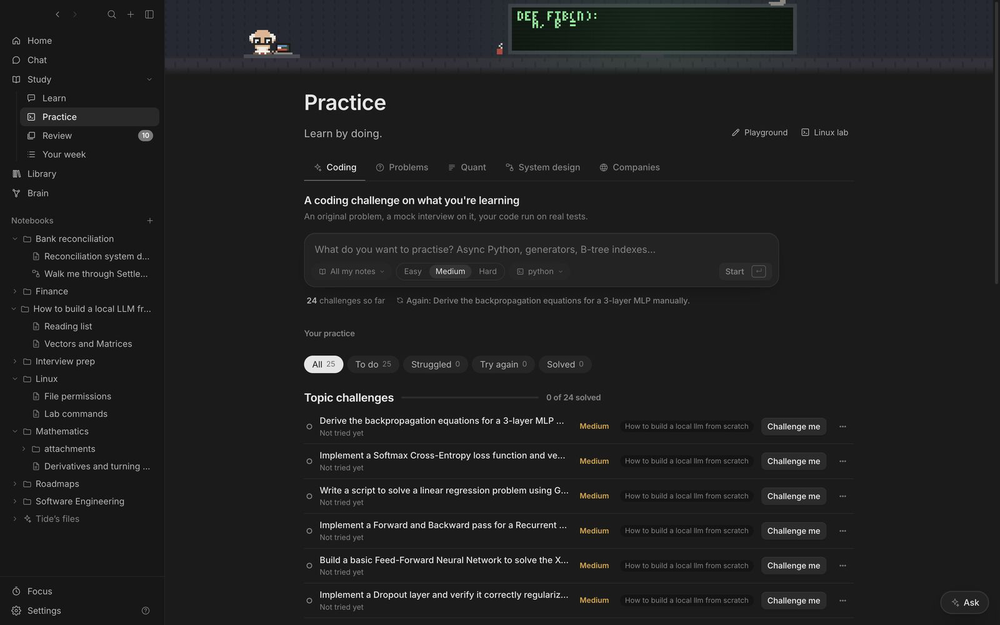

## Coding challenges

Name something you've been learning, like async Python or B-tree indexes, choose which notebook to draw on and how hard, and **Start**. The tutor writes an original challenge, runs a mock interview, runs your code against real test cases and gives you a scorecard. Challenges come back for another go, fresh each time.

## Interview problems

Paste a LeetCode link to track it by pattern. Each has a mock interview with real test cases. Struggled problems come back in two days; clean solves in a week, then two weeks, a month and two months.

## Linux lab

A real terminal in a throwaway Ubuntu container (needs Docker Desktop). The tutor asks what you know, gives you commands to try, sets up exercise files and checks what you typed. You're root, and nothing in the lab can touch your Mac; **Fresh lab** gives you a clean one. **Cards** turns the commands you ran into flashcards.

## Playground

A small editor using VS Code's editor. <kbd>⌘Enter</kbd> runs Python or JavaScript with the file's folder beside it, so a project can import its own modules and read its data files. Python can use NumPy, pandas and Matplotlib once set up, and charts appear under the output. The tutor beside it pair-programs with you: it sees the file and what it printed.

See [Prepare for an interview](15-flow-interview.md) for company prep, quant drills and system design.
