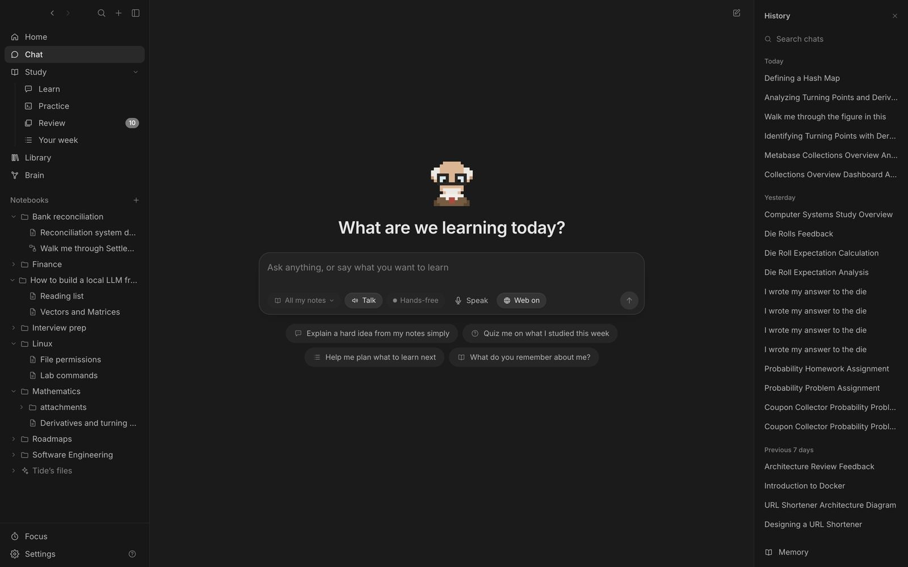

Under the box, choose what the tutor answers from (all your notes, one notebook, or nothing) and whether it may search the web. Answers show what the tutor did as a line you can open, and their sources as numbered chips; click one to open it.

History, on the right, is grouped by day. Search it, and use ⋯ to rename, pin or delete. Conversations are saved as you go in `.tide/chats/`.

## Memory

Say “remember that I'm interviewing at Bloomberg in March” and it's saved; “forget that…” removes it. The tutor also saves things on its own when you mention them. **Memory** at the bottom of the chat list shows everything it remembers, to edit or delete.

## Long conversations stay fast

When a conversation grows past about a third of the model's context, older turns are folded into a running summary right after an answer. A divider shows where it starts. Set your model's context size in Settings if it isn't 16,000 tokens.
