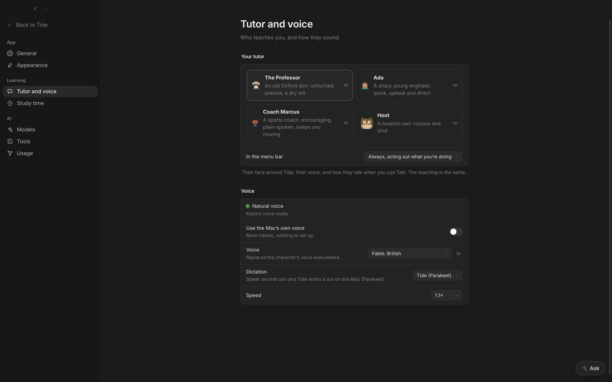

## Your tutor

**The Professor** (an Oxford don), **Ada** (a young engineer), **Coach Marcus** or **Hoot** the owl. Each has a face around Tide and in the menu bar, a voice, and a way of talking. The teaching is the same.

## Voices

| Voice | Sounds like |
| --- | --- |
| The tutor's own | The character's voice (George for the Professor) |
| Lewis | Deeper, British |
| Fable | British |
| Daniel | British |
| George | British, the Professor's |

The voice you pick replaces the character's everywhere. **Use the Mac's own voice** switches to macOS speech, more robotic but nothing to set up. **Speed** runs from 0.85× to 1.35×.

## The lecture voice beyond lessons

**Narrate** on a simulation's tour has the professor talk you through it as it runs: each step is said as the simulation does it, and the next step waits for both the words and the simulation to finish. **Pause** holds the voice and the simulation together; **Back** and **Next** carry the narration on from where you move to. The first telling is made on your Mac before it starts (Fish is slow, so this can take a minute); after that it starts at once.

In the reader, **Listen** and then **Voice** › **The professor** reads a library book in the lecture voice, made a few sentences ahead while you listen. Speed changes the tempo, not the pitch. Your place is kept to the sentence as you listen, so Listen picks up where you stopped, even after a restart. If the professor's voice doesn't answer, George reads on from the same sentence.

## Dictation

**Wispr Flow** types what you say into the answer box: **Speak** puts the cursor there and you hold your Flow key (Tide shows which). With **Talk** and **Hands-free** on, Tide leaves the microphone to Flow and sends what Flow types as soon as it finishes; start typing yourself and it waits. Use headphones in hands-free, so Flow doesn't hear the tutor. **Tide (Parakeet)** records you and writes it out on your Mac. **Deepgram (Nova-3)** writes it out in the cloud: more accurate on jargon, as the lesson's topic goes along as a hint. Paste a key from console.deepgram.com; it's checked, then kept in your Keychain. Parakeet takes anything Deepgram can't. **Handy** leaves the typing to Handy: **Speak** puts the cursor in the box and you press your Handy shortcut.

## In the menu bar

Your tutor acts out what you're doing: at the board in a lesson, tea while it's your turn, a book while you read, flashcards in Review, the stopwatch in an exam, fishing on a break. Its menu lists today's plan, starts a 25-minute focus and opens the wrap-up.

See [Talk with your tutor](14-flow-voice.md) for a spoken lesson from start to finish.
