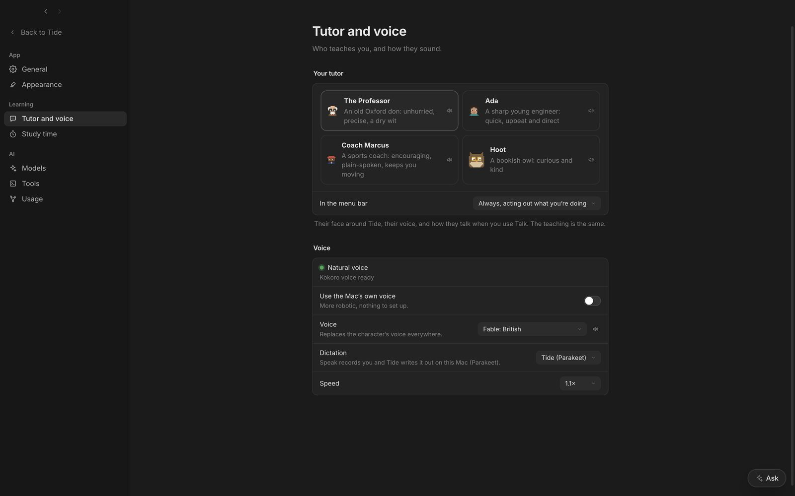

## Your tutor

**The Professor** (an Oxford don), **Ada** (a young engineer), **Coach Marcus** or **Hoot** the owl. Each has a face around Tide and in the menu bar, a voice, and a way of talking. The teaching is the same.

## Voices

| Voice | Sounds like |
| --- | --- |
| The tutor's own | The character's voice (George for the Professor) |
| Lewis | Deeper, British |
| Fable | British |
| Daniel | British |
| George | British, the Professor's |

The voice you pick replaces the character's everywhere. **Use the Mac's own voice** switches to macOS speech, more robotic but nothing to set up. **Speed** runs from 0.85× to 1.35×.

## Dictation

**Tide (Parakeet)** records you and writes it out on your Mac. **Deepgram (Nova-3)** writes it out in the cloud: more accurate on jargon, as the lesson's topic goes along as a hint. Paste a key from console.deepgram.com; it's checked, then kept in your Keychain. Private projects and Metabase lessons still use Parakeet, and so does anything Deepgram can't take. **Handy** leaves the typing to Handy: **Speak** puts the cursor in the box and you press your Handy shortcut.

## In the menu bar

Your tutor acts out what you're doing: at the board in a lesson, tea while it's your turn, a book while you read, flashcards in Review, the stopwatch in an exam, fishing on a break. Its menu lists today's plan, starts a 25-minute focus and opens the wrap-up.

See [Talk with your tutor](14-flow-voice.md) for a spoken lesson from start to finish.
